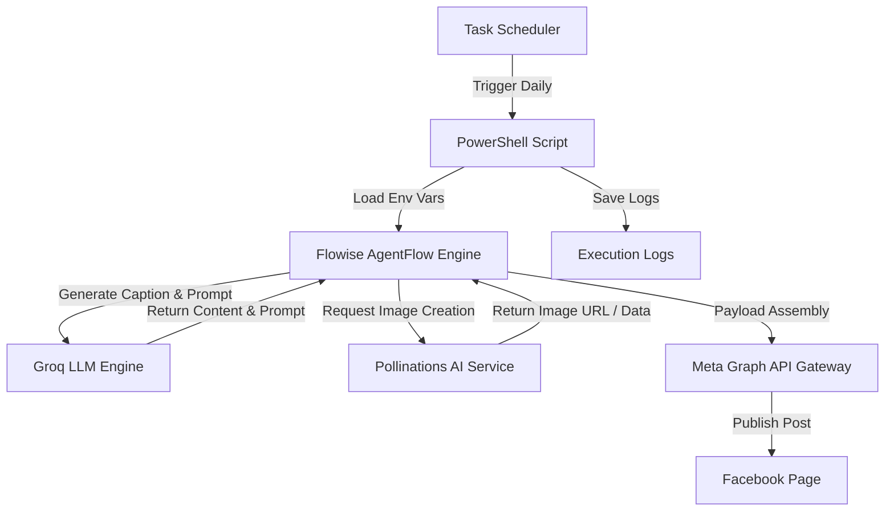

## 🏗 System Architecture & Pipeline Details

### 📐 Architecture Overview Diagram

```
+-----------------------------------------------------------------------------------+
|                                 DAILY SCHEDULER                                   |
|                          (Windows Task Scheduler / Cron)                          |
+-----------------------------------------------------------------------------------+
                                          |
                                          v
+-----------------------------------------------------------------------------------+
|                              AUTOMATION WRAPPER                                   |
|                             (PowerShell Script)                                   |
+-----------------------------------------------------------------------------------+
                                          |
                                          v
+-----------------------------------------------------------------------------------+
|                             FLOWISE AGENTFLOW                                     |
|                       (AI Orchestration Engine)                                   |
+-----------------------------------------------------------------------------------+
                       /                                     \
                      v                                       v
+-----------------------------------+   +-------------------------------------------+
|             GROQ LLM              |   |              POLLINATIONS AI              |
|   (Caption & Prompt Generation)   |   |             (Image Generation)            |
+-----------------------------------+   +-------------------------------------------+
                       \                                     /
                        v                                   v
+-----------------------------------------------------------------------------------+
|                                META GRAPH API                                     |
|                      (Publish Content to Facebook Page)                           |
+-----------------------------------------------------------------------------------+
                                          |
                                          v
+-----------------------------------------------------------------------------------+
|                              EXECUTION LOGGING                                    |
|                      (Log Files & Execution Summary)                              |
+-----------------------------------------------------------------------------------+
```

### 📊 Workflow Pipeline (Mermaid Graph)



### 🔄 Execution Pipeline Specification

| Pipeline Stage | Component / Tool | Input Data | Output Artifact | Key Responsibilities |
| :--- | :--- | :--- | :--- | :--- |
| **1. Trigger & Scheduling** | Windows Task Scheduler | Daily Time Trigger | Execution Command | Automated headless execution on fixed schedule |
| **2. Orchestration & Env** | PowerShell Script | `.env`, `config.yml` | Environment Context | Script initialization, payload formatting, error handling |
| **3. Content Generation** | Flowise + Groq LLM | Topic Prompts | Post Captions & Image Specs | High-speed LLM inference for creative copy and visual concepts |
| **4. Visual Asset Creation** | Pollinations AI | Image Prompt | Generated Image URL/Blob | Real-time AI image synthesis matching post narrative |
| **5. Publishing & Dispatch** | Meta Graph API | Access Tokens, Media & Text | Facebook Post ID | API authentication and content publishing to target Page |
| **6. Audit & Monitoring** | Logging System | Pipeline Status & Responses | Daily `.log` Files | Comprehensive tracking of execution outcomes and debugging data |
